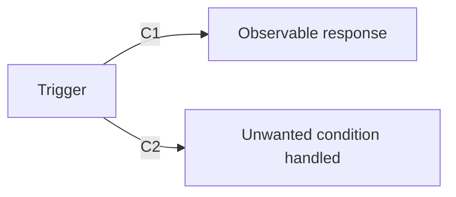

# Spec: {{KEY}} <title>

<!-- status: draft | approved. Approval = this file merged to the base branch. tier is provisional: `kai tier` computes the real one from the files the change touches. -->

## Review here

<!-- The judgments this spec rests on: assumptions, chosen numbers, added criteria, security or data implications, answers to open questions, and ADR choices. Everything else follows from the ticket. A person decides each one before the Definition PR opens, and may answer for whoever owns it. Each item names its criterion (or its section, when no criterion covers it), the decision, and who made it, adding "for <role>" when they answered for someone else. Reviewers check these first. No open question may remain when the PR opens: the definition gate fails a spec that still holds an open-question marker. -->

- <item>: <decision> (C<n> or the section; decided by <name>, for <role>)

## Context

- **Problem:** <What is wrong or missing, for whom, and how we know. From the ticket.>
- **Outcome:** <What is true for the user when this is done. The result, not the implementation.>
- **Success metric:** <Target, how it is measured, and when it is evaluated. Or "none stated in the ticket".>
- **Constraints:** <Deadlines, compliance, performance, compatibility.>
- **Out of scope:** <What this change will not do.>

## Overview

<!-- The shape of the behavior for a reviewer reading the PR: what triggers what, and what the user or caller sees, with each criterion's ID on the step it governs. The text is the source of truth: draw this once the criteria are final, from them, the Context and Interfaces touched, show nothing they don't say, and redraw it whenever they change. A Mermaid `flowchart`, `sequenceDiagram` or `stateDiagram-v2` of about a dozen nodes at most, flowchart nodes written as `id["Label"]`, every other label in plain words, and no styling, links or HTML, so GitHub renders it. With nothing worth drawing, such as a one-line fix, write "No diagram: <reason>." instead. -->

## Criteria

One sentence, one behavior, one observable result each. Every criterion must be provable before merge, by a test, a local end-to-end run, or CI output.

- **C1** When <trigger>, the system shall <observable response>.
- **C2** If <unwanted condition>, then the system shall <observable response>.

## Interfaces touched

<Surfaces, not files: endpoints, screens, tables or schemas, events, feature flags, external systems.>

## End-to-end verification

<A runnable procedure a person can follow to watch the feature work: a curl sequence, a UI walkthrough, a contract test. Checks only the deployed system can show go here too, as steps for `/kai:accept`.>

## Security

<Required for high tier: authentication, authorization, input validation, secrets, data classification, failure mode (fail closed). Otherwise "No security-relevant surface.">

## Contract

Every criterion has a row. Status stays FAIL until `/kai:prove` shows evidence.

| Criterion | Test | Status | Evidence |
|---|---|---|---|
| C1 | `proposed_test_name` | FAIL | |
| C2 | `proposed_test_name` | FAIL | |
