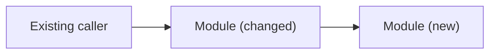

# Plan: {{KEY}} <title>

- **Spec:** [spec.md](spec.md) <!-- or the ticket link, when the change needed no spec -->
- **Status:** Proposed <!-- Proposed | Approved | Done. In a Definition PR it stays Proposed: merging the PR approves it, as it approves the spec. -->
- **Approved by:** <name, date, or "the Definition PR's merge">

## Summary

<Two or three sentences: the approach and why it is the smallest change that achieves the outcome.>

<!-- Then a diagram of what changes: the components or modules behind Files touched and how they connect, labeled "(new)" or "(changed)"; unchanged neighbors may appear unlabeled for context. Show nothing that Files touched and Tasks don't say, and redraw it if they change. A Mermaid `flowchart` for structure, `sequenceDiagram` for a call path, or `erDiagram` for a schema change, about a dozen nodes at most, flowchart nodes written as `id["Label"]`, every other label in plain words, and no styling, links or HTML, so GitHub renders it. For a change to one file or function, write "No diagram: <reason>." instead. -->

## Files touched

| Path | Change | Why |
|---|---|---|
| `src/...` | modify | <criterion or outcome it serves> |

New files: <none, or each one with its reason>
New dependencies: <none, or each one with its reason>

## Tasks

Smallest first. Each task ends green.

1. <task>

## Tests

Named by behavior. Every test maps to a spec criterion (or, without a spec, a ticket outcome); every criterion has at least one test.

| Criterion | Test | File |
|---|---|---|
| C1 | `rejects_expired_token` | `tests/...` |

## Risks

<What could break, how we would notice, how we roll back.>

## Existing decisions relied on

<ADRs, conventions, or patterns this plan follows; "none" if not applicable.>

## Verification

<`kai verify` plus any manual or end-to-end check needed to show the outcome.>
